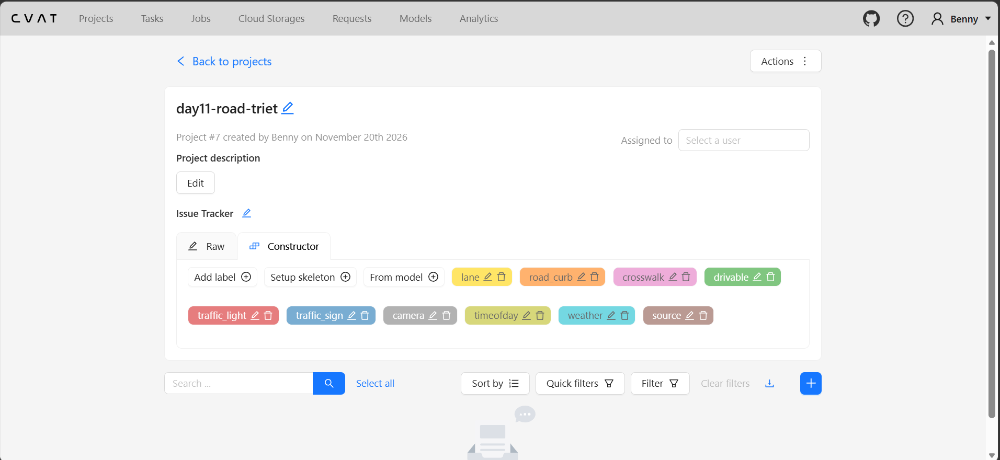
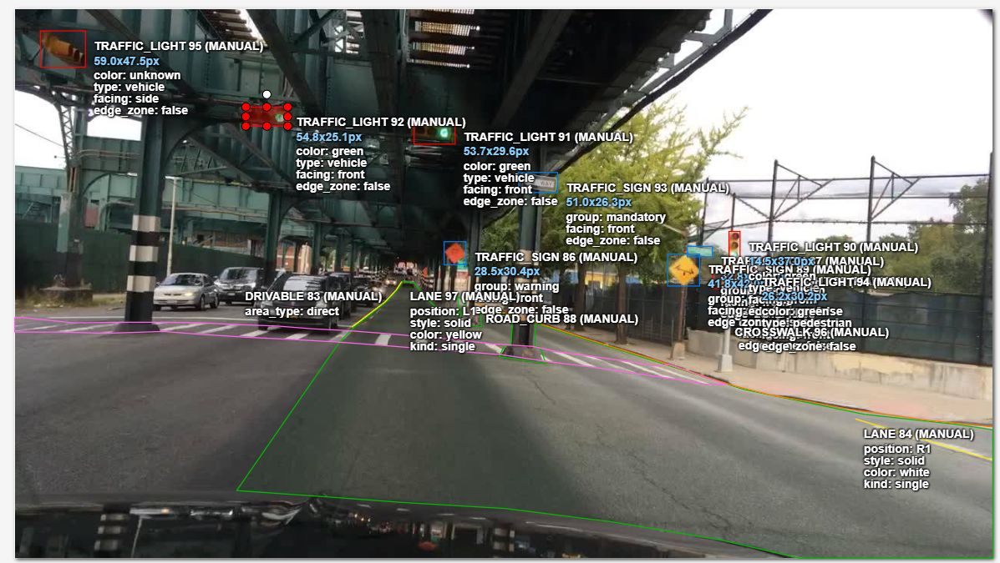
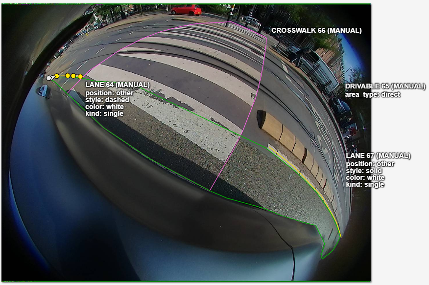
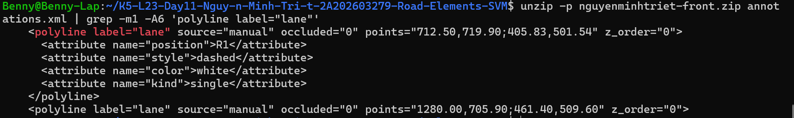

# Báo cáo cá nhân — Ngày 11
Họ tên: Nguyễn Minh Triết              Mã học viên: 2A202603279  
Phiên bản CVAT (Help → About): 2.81.0 (CVAT local chạy bằng Docker)  
Guideline: Road v1.0    Lần nộp (`revision` trong manifest): 2  
Thời điểm export (ngày giờ trên CVAT): front 21/11/2026 10:05, fisheye 21/11/2026 01:11 (giờ Việt Nam)    Số lần nộp lại sau Rework: 1

## 1. Kiểm project
| Mục | Đúng như guideline Road v1.0? | Ghi chú |
| --- | --- | --- |
| 6 label, đúng kiểu | Có | lane, road_curb (polyline); crosswalk, drivable (polygon); traffic_light, traffic_sign (rectangle). Tạo bằng cách dán Raw JSON in ra từ `python3 -m road_lab.taxonomy` vào tab Raw của project |
| Thuộc tính và giá trị | Có | Đối chiếu tab Constructor với JSON của `road_lab.taxonomy`; `road_check lint` không báo label hay thuộc tính lạ |
| 4 tag ảnh | Có | camera, timeofday, weather, source; mỗi tag là label kiểu Tag, thuộc tính select `value` |

Cách kết thúc polyline trên bản CVAT này: click lần lượt các điểm từ gần ra xa, bấm phím **N** để kết thúc.  
Cách đặt tag ảnh trên bản CVAT này: chọn công cụ Tag ở thanh trái, chọn label (camera trước tiên), rồi mở **Details** trong bảng Objects để sửa `value`, vì CVAT tự điền giá trị đầu danh sách (`front`, `clear`).

## 2. Số lượng đã gán
| Task | Ảnh | lane | road_curb | crosswalk | drivable | traffic_light | traffic_sign |
| --- | ---: | ---: | ---: | ---: | ---: | ---: | ---: |
| front | 12 | 32 | 3 | 5 | 24 | 26 | 31 |
| front-extra (đã làm 4 / 4) | 4 | 11 | 0 | 3 | 8 | 8 | 12 |
| fisheye | 8 | 9 | 7 | 9 | 11 | 6 | 3 |
| fisheye-extra (đã làm 4 / 4) | 4 | 0 | 4 | 4 | 3 | 0 | 0 |

## 3. Bảng ca khó
| Ảnh | Nhãn | Phân vân giữa | Đã chọn | Lý do |
| --- | --- | --- | --- | --- |
| A01 | drivable | lề khẩn cấp hai bên có tính `alternative` không | không gán | lề nằm ngoài vạch liền mép đường, không phải làn chạy; guideline loại lề khỏi drivable |
| A03 | lane L1 (vàng đôi) | `single` / `double`, đặt polyline trên nét nào | giữ nguyên cách vẽ | coach đã xem và xác nhận đúng |
| A04 | lane R2 | `single` / `double` (đoạn gần tách hai nét) | `double` | đoạn gần thấy hai nét song song ngăn làn xe đạp |
| A04 | traffic_light ở xa | gán hay bỏ | không gán | đèn cao dưới 8 px, coach xác nhận |
| A05 | lane | vẽ L1/R1 hay không | không vẽ | đường không có vạch sơn; QC1-02 được miễn |
| A05 | drivable | góc phải dưới là dải đỗ xe hay đường rẽ | giữ trong `direct` | lề vỉa hè bo cong sau xe SUV nên đó là góc giao lộ; guideline chưa có quy tắc cho giao lộ |
| A07 | lane L1 | vạch mờ sát dải bê tông là lane hay road_curb | lane `L1 / solid / white` | phóng to thấy vạch sơn trắng mòn, nên không dùng road_curb |
| A07 | lane | vạch trắng ngắn nằm ngang giữa R1 và R2 | không gán | không phải vạch làn dọc |
| A08 | lane L1 | màu vạch chia chiều đã mòn | `color = other` | không phân biệt được trắng hay vàng |
| A09 | lane R1 | có R1 hay không | không vẽ R1, vẽ `road_curb` | bên phải chỉ có mép lề sơn vàng; QC1-02 được miễn |
| A10 | drivable | dải giữa L1–L2 là `alternative` hay làn xe đạp | không gán | dải hẹp khoảng nửa làn, nằm giữa làn xe và dải đỗ, nên là làn xe đạp |
| A03, A04 | traffic_sign | biển nhìn mặt sau, không đọc được nội dung | `group = other`, `facing = back` | không xác định được nhóm theo chức năng |
| B04 | traffic_light (đèn đi bộ) | `edge_zone` true / false | `false` | tâm box nằm sát ngưỡng 80 % bán kính; lint xác nhận nằm trong |
| B11 | lane | gán viền ô đỗ / gạch chéo thành lane hay bỏ | không gán | guideline mục 4: vạch ô đỗ không gán lane; ảnh không có vạch làn dọc |

## 4. Phiếu QC 1 nhận được
Bạn kiểm lô của tôi: Đinh Hữu Thái An  Quyết định nhận được: Rework  
| Mã lỗi | Số lỗi | Đồng ý? | Đã sửa? |
| --- | ---: | --- | --- |
| QC1-03 (A01: L1 và R1 bị đảo cho nhau) | 2 | Đồng ý | Đã sửa: vạch đứt bên trái là `L1`, vạch bên phải là `R1` |
| QC1-06 (A01: vạch đứt để `solid`) | 1 | Đồng ý | Đã sửa thành `dashed` |
| QC1-07 (A05: thiếu polygon drivable) | 1 | Đồng ý | Đã vẽ `drivable direct` giữa hai hàng xe đỗ |
| QC1-09 (A06: biển "ONE WAY" và biển thoi vàng đảo `group`) | 2 | Đồng ý | Đã sửa: "ONE WAY" là `mandatory`, thoi vàng là `warning` |

Cả 6 lỗi An ghi đều trùng với lỗi tôi tự phát hiện khi tự kiểm lại A01–A06, và đã được sửa trong bản export lúc 10:05 ngày 21/11. Bản nộp lại dùng `revision` 2; bản cũ và manifest `revision` 1 được giữ trong thư mục `r1/`.

## 5. Kiểm file export
| File | Mở lại được? | Số shape ảnh 1 (job / file) | Số shape ảnh 2 (job / file) | Tag camera có trong XML? |
| --- | --- | --- | --- | --- |
| nguyenminhtriet-front.zip | Có (`road_check lint` đọc được 16 ảnh) | A01: 9 / 9 | A02: 5 / 5 | Có, `front` ở cả 16 ảnh |
| nguyenminhtriet-fisheye.zip | Có (`road_check lint` đọc được 12 ảnh) | B01: 4 / 4 | B02: 8 / 8 | Có, `fisheye_front/rear/left/right` đúng theo đuôi tên ảnh |

Lint lần cuối: chỉ còn 3 cảnh báo QC1-02 được miễn (A05 thiếu L1, R1; A09 thiếu R1) và 1 cảnh báo nhẹ QC1-12 (A02 drivable còn một điểm lặp ở mép trái, không làm đổi hình polygon). Manifest có `contains_images: false`.

## 6. Ảnh chụp màn hình
1. Tab Labels của project.

   
2. Một ảnh camera trước đã gán đủ (làn, vùng lái, đèn/biển).

   
3. Một ảnh fisheye đã gán, phóng to đoạn polyline cong.

   
4. Một đoạn XML có `<polyline label="lane">`.

   

## 7. Tự đánh giá
Lỗi bạn mắc nhiều nhất hôm nay (theo mã QC1-xx), và cách tránh ở Ngày 20:  
Lỗi nhiều nhất là **QC1-03 (position)**. Lần lint đầu, A11, A12, A15, A16 và B02 có nhiều lane cùng mang `L1`, vì lane mới tạo nhận giá trị mặc định `L1 / solid / white / single` và tôi quên sửa trong Details. Ở A01, L1 và R1 còn bị đảo cho nhau. Lỗi đứng thứ hai là đảo thuộc tính giữa hai object cùng loại: QC1-09 ở A06 (biển "ONE WAY" và biển thoi vàng bị đổi `group` cho nhau). Cách tránh ở Ngày 20: mở Details sửa thuộc tính ngay sau khi bấm N, trước khi vẽ object tiếp theo; vẽ theo thứ tự cố định L1 → R1 → L2 → R2; chạy `road_check lint` sau mỗi 3–4 ảnh để bắt cảnh báo "2 polyline cùng position" sớm.

Nhãn của bạn đi vào model ở đâu? Chọn một lỗi đã sửa và nói nó làm model học sai thế nào:  
Polyline `lane` được đổi thành đích huấn luyện của model làn, ví dụ dạng row-anchor: ở mỗi hàng y, mỗi vị trí làn (L1, R1, L2, R2) có một ô dự đoán tọa độ x. Thuộc tính `position` quyết định polyline rơi vào ô nào. Lỗi đã sửa ở A01 (L1 và R1 bị đảo) sẽ dạy model rằng vạch bên phải xe là "vạch trái của làn mình". Khi đó tâm làn mà hệ thống giữ làn (LKA) tính ra sẽ lệch hoặc đổi dấu, và xe có thể bị lái về sai phía. Lỗi này nằm ngay ở hàng gần xe, nơi ảnh hưởng mạnh nhất tới điều khiển, nên Road v1.0 xếp nó vào mức nặng.

## 8. (Tùy chọn, buffer) Từ polyline đến đích row-anchor
| y | 720 | 680 | 640 | 600 | 560 |
| --- | ---: | ---: | ---: | ---: | ---: |
| x của chúng tôi |  |  |  |  |  |
| x của bạn kia |  |  |  |  |  |
